  
  
  
  

 

<table>
<tr>
<td width="62%" valign="top">

### Sobre mí

Soy Martín, de Villavicencio. Estudio Ingeniería de Sistemas en la Cooperativa, pero casi todo lo que sé lo aprendí sacando proyectos para clientes de verdad.

Empecé con Java y Oracle en la U, haciendo sistemas de nómina y citas médicas. Después me pasé a la web y hoy tengo varias plataformas corriendo en mi propio VPS: una tienda de gorras que vende por drops, un sistema de reservas de canchas con pagos por Wompi, un software para restaurantes donde los meseros toman pedidos desde el celular y una app agrícola con un asistente de IA que responde sobre cultivos.

Con **Llano Studio** le hago software a negocios de la región: tiendas, fincas para alquilar, restaurantes. En los ratos libres armo bots de Discord para comunidades de Minecraft y servidores de juego.

</td>
<td width="38%" valign="top">

### Ahora mismo

📱 Sacando las versiones **Flutter** de ReservaTuCancha y MeSoft

🧪 Probando **Astro** y **Vue** en proyectos nuevos

🌾 Llevando proyectos de clientes en **Llano Studio**

🐳 Moviendo todo a **Docker** + **Nginx** en mi VPS

💬 Abierto a freelance: **martinvelasquezdev@gmail.com**

</td>
</tr>
</table>

 

## Stack

   
   
  

  
  
  
  
  
  
  
  
  

 

## Proyectos en producción

<table>
<tr>
<td width="50%" valign="top">

### 🧢 [Cuscus Hats](https://cuscushats.com)
Tienda de gorras que lanza colecciones por **drops** limitados con cuenta regresiva.

   

</td>
<td width="50%" valign="top">

### 🎾 [ReservaTuCancha](https://reservatucancha.site)
Reserva de canchas en **tiempo real** con pagos por Wompi. Web y app móvil.

   

</td>
</tr>
<tr>
<td width="50%" valign="top">

### 🍽️ [MeSoft](https://mesoft.store)
SaaS **multi-tenant** para restaurantes: mesas, pedidos, inventario, nómina y reportes.

   

</td>
<td width="50%" valign="top">

### 🌾 [AgroManager Pro](https://agromanager.pro)
Gestión agrícola: parcelas, siembras, riego y finanzas, con **AgroBot**, un asistente IA.

   

</td>
</tr>
<tr>
<td width="50%" valign="top">

### 🏡 [Rently](https://github.com/Martinvb07/Rently)
Reservas de **fincas** en Colombia: calendario, temporadas, panel admin y PWA instalable.

  

</td>
<td width="50%" valign="top">

### 🖥️ [MartinHQ Monitor](https://github.com/Martinvb07/monitor-vps)
Dashboard para vigilar mi **VPS**: contenedores, recursos y acceso con 2FA.

  

</td>
</tr>
</table>

<b>Más proyectos</b>

 

| | Proyecto | Qué es | Stack |
|---|---|---|---|
| 🌎 | [SismoCOL](https://github.com/Martinvb07/SismoCOL) | Monitoreo de actividad sísmica en Colombia | TypeScript |
| 🍀 | Clover Bot | Bot para servidores de venta de construcciones de Minecraft | Discord.js · MySQL |
| 🤖 | GeoWorldMC Bot | Bot oficial de Discord de geoworldmc.net | Discord.js · MySQL · Docker |
| ☕ | Sistema Gestión J | Nómina y permisos para una empresa | Java · Swing · Oracle |

 

## Actividad

  
  

  

<picture>
  <source media="(prefers-color-scheme: dark)" srcset="https://raw.githubusercontent.com/Martinvb07/Martinvb07/output/snake-dark.svg" />
  <source media="(prefers-color-scheme: light)" srcset="https://raw.githubusercontent.com/Martinvb07/Martinvb07/output/snake.svg" />
  
</picture>

 

  

